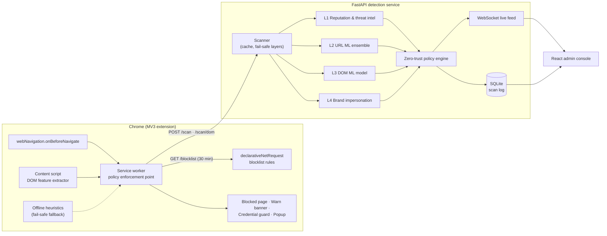
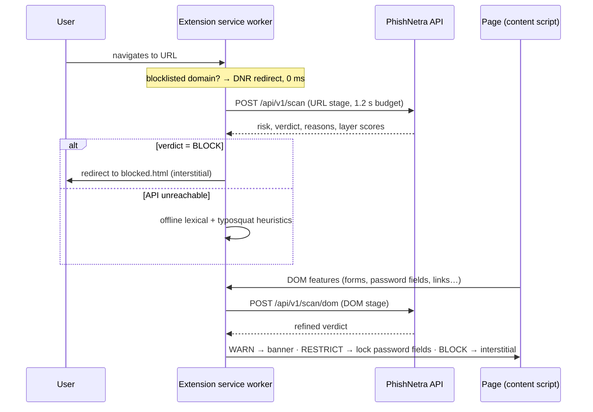
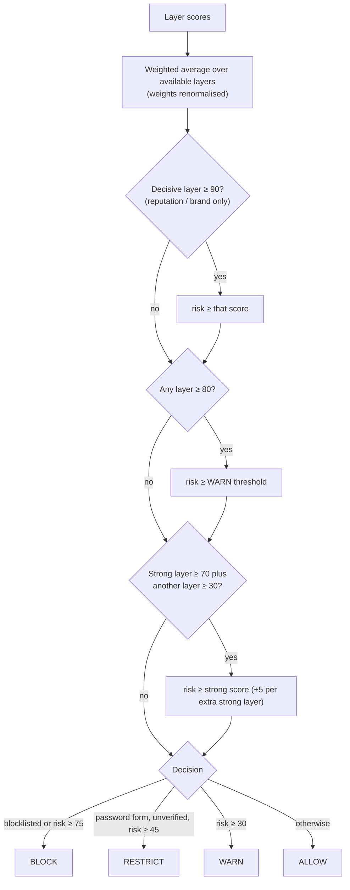

# PhishNetra Architecture

PhishNetra is a **multi-layered, AI-driven, zero-trust** phishing defence. It verifies every
top-level navigation in the browser before trusting it, fuses evidence from four independent
detection layers into one explainable risk score, and enforces the result at browser level.

## 1. System overview

## 2. Two-stage verification of a navigation

**Stage 1 (pre-navigation)** uses only what is known from the URL: reputation, lexical ML and
brand typosquatting. **Stage 2 (post-load)** adds page structure (Layer 3) and page-content
impersonation (title/text claims a brand that does not own the domain). Single-page apps that
render the login form late trigger one re-scan when a password field appears.

## 3. Detection layers

| Layer | Input | Technique | Output examples |
|---|---|---|---|
| **L1 Reputation & intel** (`backend/app/layers/reputation.py`) | domain | Allowlist (Tranco), blocklist (OpenPhish + user reports), WHOIS age, TLS verification, TLD reputation, free-hosting detection | "Domain registered only 4 days ago" |
| **L2 URL ML** (`url_model.py`) | URL string | Soft-voting ensemble: char 3–5-gram TF-IDF + 33 lexical features → logistic regression; lexical features → histogram gradient boosting | "URL classifier rates this 93 % likely phishing" |
| **L3 DOM ML** (`dom_model.py`) | 25 PhiUSIIL HTML features from the live DOM | Random forest | "Password form submits credentials to a different domain" |
| **L4 Brand impersonation** (`brand.py`) | host, title, text, favicon | Homoglyph skeletons (TR39 subset + leetspeak), Levenshtein typosquatting, combosquatting, content brand claims, favicon pHash | "Homoglyph spoof of PayPal: 'pаypal' imitates 'paypal'" |

Every layer returns a `LayerResult(score 0–100 | None, reasons, details)`. A layer that crashes
or has nothing to judge returns `None` and is excluded from the weights (fail-safe, not fail-open).

## 4. Zero-trust policy engine (`backend/app/policy.py`)

Zero-trust principles applied:

* **Never trust, always verify** — every top-level navigation is scored; unknown domains start
  with baseline risk 15, not 0.
* **Least privilege for credentials** — on an unverified domain with a password form, risk ≥ 45
  puts the page in `RESTRICT`: password inputs are locked and form submission is intercepted in
  the capture phase until the user explicitly confirms.
* **Trust expires** — verdicts are cached for 15 minutes only; user overrides last 30 minutes and
  are logged for audit.
* **Evidence-proportional enforcement** — statistical ML layers alone can WARN but cannot BLOCK;
  blocking needs decisive evidence (blocklist, brand spoof) or corroboration between layers.
* **Degrade safely** — if the API is unreachable, the extension falls back to offline heuristics
  instead of failing open.

All weights and thresholds live in `backend/config.yaml` for experimentation.

## 5. Browser-level mitigation

| Verdict | Mechanism |
|---|---|
| `BLOCK` | `chrome.tabs.update` to an interstitial with risk, reasons and layer breakdown; blocklisted domains are redirected by `declarativeNetRequest` before any request is sent |
| `RESTRICT` | Content script locks `input[type=password]`, intercepts `focusin`/`submit` in the capture phase, shows a confirm dialog |
| `WARN` | Shadow-DOM banner (page CSS can't hide it) with reasons and report / mark-safe buttons |
| `ALLOW` | Badge ✓ |

User feedback (`Report phishing` / `It's safe`) updates the blocklist/allowlist immediately and is
stored for future retraining.
